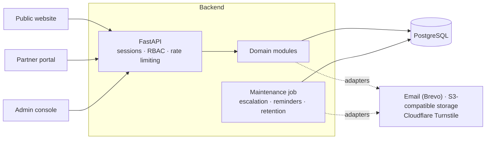

<div align="center">

# CoralSwift Backend

**The API behind the Coral Swift website, partner portal and admin platform.**<br>
Public enquiries and content, secure partner onboarding and review, and an admin console for operations teams.

[](https://github.com/syedvpd/coralswift-backend/actions/workflows/ci.yml)


[Quick start](#quick-start) · [API](#api) · [Architecture](#architecture) · [Security](#security) · [Operations](#operations) · [Documentation](#documentation)

</div>

---

## Contents
[Overview](#overview) · [Quick start](#quick-start) · [API](#api) · [Architecture](#architecture) · [Modules](#modules) · [Security](#security) · [Configuration](#configuration) · [Database](#database) · [Operations](#operations) · [Testing and quality](#testing-and-quality) · [Deployment](#deployment) · [Project structure](#project-structure) · [Documentation](#documentation) · [License](#license)

## Overview
Coral Swift connects businesses and delivery partners across IT, non-IT and partnership services. This service provides:

| Audience | What the API gives them |
|---|---|
| **Visitors** (public website) | Contact, project, partner and strategic enquiries with secure document upload, reference numbers and status lookup; meeting requests; newsletter and privacy requests; published insights, FAQs and downloads |
| **Partners** (portal) | Invitation-based sign-in with optional MFA, company profile with completion tracking, private document vault with versions and expiry, application workflow, reviewer messages, notifications and change history |
| **Reviewers and staff** (admin console) | Role-based access, enquiry and lead management, assignment and follow-ups, partner database, six-stage application review, content approval, claims register, reports with CSV export, audit trail, templates and system settings |

It is a **modular monolith**: one FastAPI service, PostgreSQL as the single source of truth, and a scheduled maintenance job.

## Quick start
```bash
git clone https://github.com/syedvpd/coralswift-backend.git
cd coralswift-backend
python -m venv .venv
.venv/Scripts/pip install -r requirements-dev.txt     # Linux/macOS: .venv/bin/pip
cp .env.example .env                                  # fill in your own values; never commit .env
docker compose up -d db                               # local PostgreSQL
.venv/Scripts/uvicorn app.main:create_app --factory --reload
```
Interactive docs are at `http://localhost:8000/docs` in development (disabled in staging and production).

## API
| | |
|---|---|
| Base path | `/api/v1` (health probes at `/health/live`, `/health/ready`) |
| Explore | Swagger UI at `/docs`, OpenAPI JSON at `/openapi.json` (development only) |
| Auth | Opaque session tokens with refresh rotation and replay detection; Argon2id password hashing; TOTP MFA with recovery codes; invitation-only accounts |
| Responses | Consistent envelope with `data` and `meta`; errors as `{ "error": { "code", "message" } }` with a request id on every response |
| Safe retries | `Idempotency-Key` header on public submissions |
| Pagination | `page` and `page_size` with enforced maximums |

| Area | Prefix |
|---|---|
| Public | `/enquiries/*`, `/documents/upload`, `/meetings`, `/newsletter/*`, `/privacy/requests`, `/content/*`, `/catalog/*`, `/site/contact` |
| Authentication | `/auth/*` (login, refresh, logout, MFA, password reset, invitations, sessions) |
| Partner | `/partner/*` (organization, documents, applications, messages, notifications) |
| Reviewer | `/reviewer/*` |
| Admin | `/admin/*` (enquiries, organizations, staff, content, claims, reports, settings, audit) |

Contracts: [phase 1](docs/architecture/phase-1-api-contracts.md) · [partner portal](docs/api/phase-2-api-contract.md) · [admin](docs/api/phase-3-api-contract.md).

## Architecture

* **PostgreSQL is authoritative.** Business state, the notification outbox, idempotency keys and the append-only audit trail all live in the database.
* **Request flow:** router, then service, then models. Routers authenticate, authorise and validate; services own business rules and state transitions.
* **Providers are adapters** selected by configuration: console or Brevo email, local or S3-compatible storage, optional Turnstile bot check.
* **Notifications use an outbox** with deduplication, retries and a visible failure queue for staff.

## Modules
| Module | Covers |
|---|---|
| `enquiries`, `projects`, `partners`, `strategic` | General, project, partner and strategic submissions, routing, SLA and status lookup |
| `documents` | Validated uploads to private storage |
| `auth` | Login, sessions, refresh rotation, MFA, invitations, password reset |
| `organizations` | Partner companies, memberships, profile history and change requests |
| `partner_documents` | Versioned private documents, review, expiry and audited download |
| `applications`, `reviews`, `messaging` | Application lifecycle, reviewer workflow, information requests and responses |
| `admin` | Lead management, partner database, settings, templates, reports, audit, maintenance jobs |
| `content` | Pages, insights and downloads with approval workflow and a claims register |
| `engagement` | Meeting requests, newsletter opt-in, privacy requests |
| `catalog` | Project categories, partner criteria and public contact details |
| `notifications` | Templates, outbox, delivery and retries |

## Security
| Topic | How it is handled |
|---|---|
| Authentication | Argon2id, lockout after repeated failures, rotating refresh tokens, TOTP MFA (required for staff in production) |
| Authorisation | Least-privilege roles (Super Administrator, Business Development Manager, Partner Reviewer, Content Administrator); object-level checks; organisation isolation (foreign ids return 404) |
| Confidentiality | Strategic enquiries and financial documents restricted by role; private storage; no public file URLs; audited downloads |
| Uploads | Type, size and content checks; server-generated storage keys; files held in quarantine until a scanner is configured |
| Abuse protection | Rate limiting, Cloudflare Turnstile bot check, request-size limit, idempotent submissions |
| Transport and headers | HTTPS expected at the edge; HSTS, security headers, CORS allow-list and trusted hosts |
| Data protection | Minimal data collection, privacy requests with deletion workflow, configurable retention |
| Audit | Append-only activity log (database trigger) with actor and request id |
| Secrets | Environment only; staging and production refuse to start with placeholders, debug mode, wildcard hosts or missing integrations |

**Reporting a vulnerability.** Please do not open a public issue. Contact the repository owner privately.

## Configuration
Settings come from environment variables ([`.env.example`](.env.example) lists every name; copy it to `.env`).

| Group | Variables |
|---|---|
| App | `APP_ENV` (`development`, `testing`, `staging`, `production`), `DEBUG`, `LOG_LEVEL`, `PORTAL_BASE_URL` |
| Database | `DATABASE_URL`; `TEST_DATABASE_URL` (a disposable local `*_test` database, used only by the test suite) |
| Security | `SECRET_KEY`, `STAFF_MFA_REQUIRED`, `CORS_ALLOWED_ORIGINS`, `ALLOWED_HOSTS`, `RATE_LIMIT_PER_MINUTE`, `MAX_REQUEST_BODY_BYTES`, `CAPTCHA_ENABLED`, `TURNSTILE_SECRET_KEY`, `TURNSTILE_ALLOWED_HOSTNAMES` |
| Storage | `STORAGE_BACKEND` (`local` or `s3`), `S3_*` |
| Email | `EMAIL_BACKEND` (`console` or `brevo`), `BREVO_API_KEY`, `EMAIL_SENDER_ADDRESS`, `EMAIL_RECIPIENT_ALLOWLIST`, `NOTIFY_*_EMAILS` |
| Compliance | `PRIVACY_NOTICE_VERSION` |

Staging and production share a strict profile enforced at start-up. Staging additionally requires `EMAIL_RECIPIENT_ALLOWLIST` so test environments cannot email real recipients.

## Database
Schema changes are reviewed, additive Alembic migrations in [`migrations/versions`](migrations/versions).
```bash
python scripts/alembic_test_db.py upgrade head     # guarded helper: local *_test database only
python scripts/alembic_test_db.py check            # models and migrations agree
```
For a shared database, check the target (`alembic current`), take a backup, and apply with `alembic upgrade head`. Applied migrations are never edited, and databases are never dropped or reset by the tooling.

## Operations
**Staff accounts**
```bash
STAFF_PASSWORD=... python scripts/create_staff_user.py --email a@b.com --name "Name" --role super_administrator
```

**Scheduled maintenance** (`scripts/run_maintenance.py`, run from the repository root; it reads `.env` from the current directory)

| Command | Effect |
|---|---|
| `python scripts/run_maintenance.py --dry-run` | Safe preview: counts what each job would act on in a read-only transaction. Changes, queues and sends nothing |
| `python scripts/run_maintenance.py` | Runs all jobs |
| `docker run --rm --env-file .env <image> python scripts/run_maintenance.py [--dry-run]` | Same, inside the image |

Jobs: idempotency-key cleanup, SLA escalation, document expiry reminders, retention purge of stored files, and notification dispatch with retries. The retention purge deletes files from storage and notification dispatch sends real email, so check the target `DATABASE_URL`, `STORAGE_*` and `EMAIL_*`, take a verified backup, review the dry-run counts and obtain authorisation before a real run against shared or production data.

## Testing and quality
```bash
ruff check . && ruff format --check . && mypy && pytest -q
```
Tests run against a disposable local PostgreSQL database (the suite refuses any database whose name does not end in `_test`) with in-memory storage and mocked email and CAPTCHA providers. The CI workflow runs the same gates, validates migrations on a fresh database, builds the app and builds the Docker image ([`ci.yml`](.github/workflows/ci.yml)).

## Deployment
* **Docker:** the [`Dockerfile`](Dockerfile) builds a non-root image that honours `$PORT` and serves `/health/live` and `/health/ready`.
* **Render:** [`render.staging.yaml`](render.staging.yaml) (staging) and [`render.yaml`](render.yaml) (production) declare the API web service and the maintenance cron job. Secrets are set in the dashboard and never stored in the repository.
* **Runbooks:** [deployment guide](docs/deployment/render-deployment-readiness.md) · [staging checklist](docs/deployment/staging-release-checklist.md).

## Project structure
```
coralswift-backend/
├── .github/workflows/   # CI pipeline
├── app/
│   ├── api/             # versioned router
│   ├── common/          # envelopes, idempotency, utilities
│   ├── core/            # settings, security, errors, logging, rate limiting
│   ├── database/        # engine and sessions
│   ├── integrations/    # email, storage and bot-check adapters
│   ├── modules/         # domain modules (see Modules)
│   └── main.py          # application factory
├── migrations/          # Alembic migrations
├── scripts/             # staff creation, maintenance, guarded migration helper
├── tests/               # unit, integration and API tests
├── docs/                # architecture, API contracts, engineering and deployment guides
├── Dockerfile
├── docker-compose.yml   # local PostgreSQL
├── render.yaml          # production blueprint
├── render.staging.yaml  # staging blueprint
└── README.md
```

## Documentation
| Topic | Location |
|---|---|
| Architecture and data models | [docs/architecture](docs/architecture) |
| API contracts | [docs/api](docs/api) |
| Engineering standards | [docs/engineering](docs/engineering) |
| Deployment and staging | [docs/deployment](docs/deployment) |
| Decisions | [docs/decisions](docs/decisions) |

## License
Proprietary. All rights reserved.
